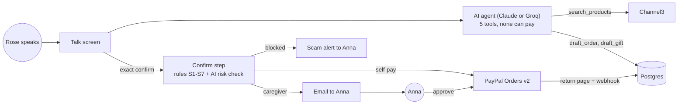

# CareCart

**Pay for what you asked for, safely: voice-first shopping for older and blind shoppers, with a caregiver safety net on PayPal.**

Built for the [PayPal AI Hackathon 2026](https://paypalaihackathon.devpost.com).

- Live demo: https://carecart-seven.vercel.app
- Demo video: _add your YouTube link here_
- How it works, layer by layer: [docs/walkthrough.md](docs/walkthrough.md)

## How it works

1. **Rose speaks**: "I need some reading glasses." (She can also type.)
2. **The AI finds options**: the agent searches real products through Channel3 and reads three of them aloud, with prices in words.
3. **The app reads the order back**: item, total and store. Only an exact "confirm" / "yes" or the Confirm button continues.
4. **Safety rules run**: plain, unit-tested code decides the route.
5. **Payment**:
   - **Small, normal orders:** Rose pays with PayPal herself, with voice guidance.
   - **Large, unusual or flagged orders:** Anna, her caregiver, gets an email, reviews the request and pays with her own PayPal.
   - **Scams:** a gift card or "the bank told me to pay" is blocked, explained kindly, and Anna is alerted.
6. **Gifts to family:** "Send Sam twenty dollars." Sam must be on the list of people Anna approved. The app reads the gift back, and the same rules run:
   - **Small gifts:** Rose pays with PayPal and the money goes straight to Sam's PayPal account. Nothing ships.
   - **Over Rose's limit, over the daily cap or otherwise flagged:** Anna gets an email and says yes or no. Her yes doesn't make her pay: Rose hears "Anna said yes to your gift to Sam. Say send it, and I'll open PayPal" and sends it herself.
   - **Someone not on the list:** nothing is drafted, and Anna gets an "Add Sam" email.
   - **"Sam's in jail, send bail money":** blocked, explained kindly, and Anna is warned, even if Rose never confirms.

## Safety design: the AI talks, code moves the money

The AI agent has exactly five tools: `search_products`, `draft_order`, `draft_gift`, `get_order_status` and `explain_safety_flag`. **None of them can create, approve, capture or refund a payment.** Confirmation, the safety rules and every PayPal call live in ordinary, tested code.

| # | Rule | Result |
|---|---|---|
| S1 | Gift cards, prepaid cards, crypto or money transfers, or scam phrases ("the bank called", "IRS", "bail", "keep it secret", "grandson in trouble", …) | **Blocked**; Anna is alerted |
| S1 | The word "urgent" | Goes to Anna |
| S2 | Total over Rose's own limit (default $25) | Goes to Anna |
| S3 | Today's total would pass the daily cap (default $60) | Goes to Anna |
| S4 | More than 3× Rose's usual order (needs ≥ 3 past orders) | Goes to Anna |
| S5 | A store Rose hasn't used, over $15 | Goes to Anna |
| S6 | The same item ordered within 10 minutes | Rose is asked to confirm again |
| S7 | The AI risk check rates it high | Goes to Anna |

**The AI can only add caution, never remove it.** If the AI risk check fails, the rules alone decide.

**Sending money to family** gets the same rules (S2, S3, S4, S6 and S7 apply as they do to purchases), plus these:
- **Anna's list decides who can get money.** Rose can only send to people on it. Anna adds them (name, relationship, PayPal email) and removes them on her page. The recipient's PayPal email always comes from the list, never from the conversation, and the AI never sees an email address. It only passes along the name Rose said, and code matches it to the list: exact name or relationship first ("Sam", "my grandson"), then a whole-word name inside the phrase ("my grandson Sam").
- **The AI can't add people.** `draft_gift` only drafts. If the name isn't on the list, Anna gets an email with an "Add Sam" link that works once, for 7 days, for that one name. It opens a form for that person's PayPal email and nothing else. Removing people needs Anna's own page.
- **The scam check runs at draft time, before the amount limit.** "Sam's in jail, send $5,000 bail" is blocked and Anna is warned straight away, even if Rose never says confirm. Words like "jail", "arrested", "lawyer", "accident", "hospital", "new phone number" and "courier" count for gifts, on top of the purchase phrases (so a shopper can still buy "a hospital bed").
- **S5 (a new store) is skipped for gifts**; the trusted list replaces it. A payable gift is from 1 cent to $500.
- **Anna's yes hands the payment back to Rose.** It stays Rose's money. Anna's yes covers only that exact amount and person, and if Anna removes the person before Rose sends it, it fails.



## PayPal usage

- **Orders v2:** orders are created with `payment_source.paypal.experience_context` (`PAY_NOW`, `SET_PROVIDED_ADDRESS`) and captured on return. Every create and capture sends a `PayPal-Request-Id`, so a retried request never charges twice.
- **Order tracking:** `POST /v2/checkout/orders/{id}/track` adds the shipment to the PayPal order, which protects the seller in disputes.
- **Gifts pay a family member directly:** a gift is an Orders v2 order whose `purchase_units[0].payee.email_address` is the family member's PayPal email (item category `DIGITAL_GOODS`, `NO_SHIPPING`). Rose approves it and our app captures it, so the money lands in Sam's account with no forwarding step and no payout. The email comes only from Anna's trusted list.
- **Webhooks:** `PAYMENT.CAPTURE.COMPLETED` and `PAYMENT.CAPTURE.DENIED`, verified with `/v1/notifications/verify-webhook-signature`. The raw event bytes are passed to verification unchanged.
- Order statuses only move forward. The webhook and the return page can both arrive, and the order is still marked paid exactly once.

**Verified in the PayPal sandbox:** Rose's self-pay capture, Anna's approve-and-pay capture from the email link, the scam block with its alert email, and USPS tracking stored on both PayPal orders. On Oct 24, 2026, a $1.00 gift order paid by the Rose buyer was captured `COMPLETED`, with Sam's sandbox account as the payee.

The PayPal REST API is called directly. The hosted sandbox MCP server was failing for every hackathon participant at build time, and PayPal staff confirmed that direct REST calls are fine.

## AI tools used

- **The conversation agent, risk check and caregiver summary:** **Claude Sonnet 5.5** (Anthropic API, TypeScript SDK tool runner) by default. The live demo currently runs on **`openai/gpt-oss-120b` on Groq** (free tier) through the same code, switched with one setting (`AI_PROVIDER`).
- **Orpheus** (Canopy Labs' open voice model, voice "hannah") on Groq: the natural voice for every reply.
- **Whisper** (`whisper-large-v3-turbo`) on Groq: transcribes speech on phones and in Firefox.
- **Web Speech API** (built into the browser): live recognition on desktop Chrome, Edge and Safari, and the fallback voice.
- **Channel3 API:** real product search.
- **Claude Code** (Anthropic) was used during development for planning, writing code and tests, and code review.

## Voice

- **Speaking:** replies use **Orpheus** (an open-source voice model, voice "hannah") through Groq when `VOICE_API_KEY` (or a Groq `AI_API_KEY`) is set. Replies are split into pieces of up to 200 characters and played in order. If Groq is unavailable or rate-limited, the browser's own voice takes over automatically, using the most natural English voice installed.
- **Listening:** desktop Chrome, Edge and Safari use their built-in speech recognition and keep listening until about 2 seconds of silence. **Phones and Firefox** record the microphone instead (Chrome on Android repeats words in continuous recognition), and **Whisper** (`whisper-large-v3-turbo`) on Groq transcribes it in about half a second.
- **Speed:** "slower" and "faster" (or "speak the slowest you can") change the speed, and the confirmation is already said at the new speed.
- **Limits:** Groq's free tier allows Orpheus only a few thousand tokens a day, and `DAILY_SPEECH_CAP` adds our own cap. Past either, replies use the browser voice.
- **Privacy:** with the Groq voice on, reply text is sent to Groq to be spoken, and in browsers without built-in recognition, the recording of what Rose says is sent to Groq to be transcribed. Chrome's built-in recognition sends audio to Google.

## Accessibility

- **One menu on every page** (Home, Talk, My orders, Anna's page, Demo store) with `aria-current`, plus a band saying whose view you're in ("You are Rose, the shopper").

The target is WCAG 2.2 AA.
- Large text with A+ / A− controls, high contrast, buttons at least 64px tall, and a visible focus outline.
- Tap to talk (no holding a button down). Voice commands that always work: "repeat", "slower", "cancel", "help", "go back".
- **Keyboard:** Space = talk, 1–3 = pick an option, Enter = confirm, Esc = cancel.
- **Screen-reader mode:** the app's own voice turns off and replies are announced through an `aria-live` region, so two voices never talk over each other.
- Browsers without speech recognition get a large text box.
- axe-core checks run in the Playwright tests.

## Hosting

Vercel, in region **sin1** (Singapore, next to the Neon database). That halved response times compared with Washington: a conversation turn went from 2.2 s to 1.1 s (see `docs/latency.md`).

## Run locally

```bash
cp .env.example .env.local   # fill in every value
npm install
npm run db:migrate
npm run dev
```

**PayPal sandbox setup:** create a **US** sandbox Business account (the store), two **US** Personal accounts for the buyers (Rose and Anna), a third **US** Personal account for Sam (put its email in `DEMO_FAMILY_EMAIL`; gifts land there), and a REST app linked to that Business account; its client ID and secret go in `.env.local`. Default sandbox accounts take the developer account's country, and a non-US buyer or store fails on this USD, US-address checkout with "This seller doesn't accept payments in your currency".

**AI provider:** Claude is the default. To run on a free OpenAI-compatible API instead (Groq or Gemini), set `AI_PROVIDER=openai-compatible` plus `AI_BASE_URL`, `AI_API_KEY` and `AI_MODEL`; `.env.example` lists both presets. Switching back to Claude is one line: `AI_PROVIDER=anthropic` (or empty) with `ANTHROPIC_API_KEY` set. Both providers share the same five tools, prompt and safety rules.

**Tests and checks:**

```bash
npm test                     # unit tests (the database suite runs only when TEST_DATABASE_URL is set)
npm run e2e                  # Playwright + axe tests (needs TEST_DATABASE_URL, a separate test database)
npm run smoke                # live calls to Channel3, PayPal, Resend, the AI (risk check and two agent turns, one a scam-shaped gift request) and the voice
npm run demo:order -- selfpay   # or caregiver / scam: a real order through the confirm step, no Claude needed
```

`demo:order` puts the order in the newest demo household, so click **Try as Rose** first and open the PayPal link it prints in the same browser.

## Testing the hosted demo

Open the demo and click **Try as Rose**. To pay, log in with the PayPal **sandbox** buyer accounts listed in the Devpost "Testing instructions" field. They are sandbox-only accounts; no real money moves.

## Limitations

- PayPal **sandbox only**.
- The demo store is the seller of record for Channel3 products.
- Emails go only to the configured `DEMO_CAREGIVER_EMAIL` (Resend's test sender).
- Gifts go to PayPal **sandbox** accounts only. Each new demo comes with one trusted person, Sam (grandson), whose email is `DEMO_FAMILY_EMAIL`; a demo started before that needs Anna to add him. A gift is from 1 cent to $500, in US dollars, and PayPal doesn't check who Sam really is: Anna vouches for him.
- Demo households are reached by link and cookie, with no login. Anyone with a caregiver request link can act on it.
- English only.
- Groq's free Orpheus quota covers a few dozen spoken replies a day; after that the browser voice speaks.
- Channel3 has no grocery items, so the demo uses things like reading glasses and large-print crossword books.

## License

MIT
